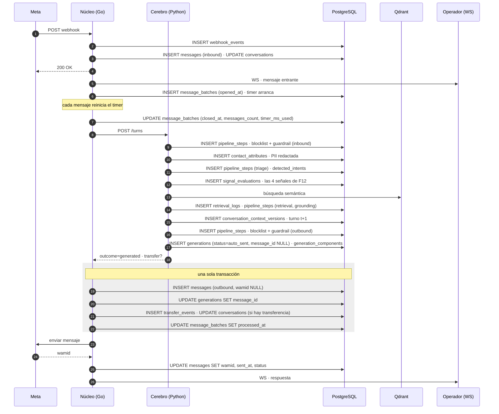
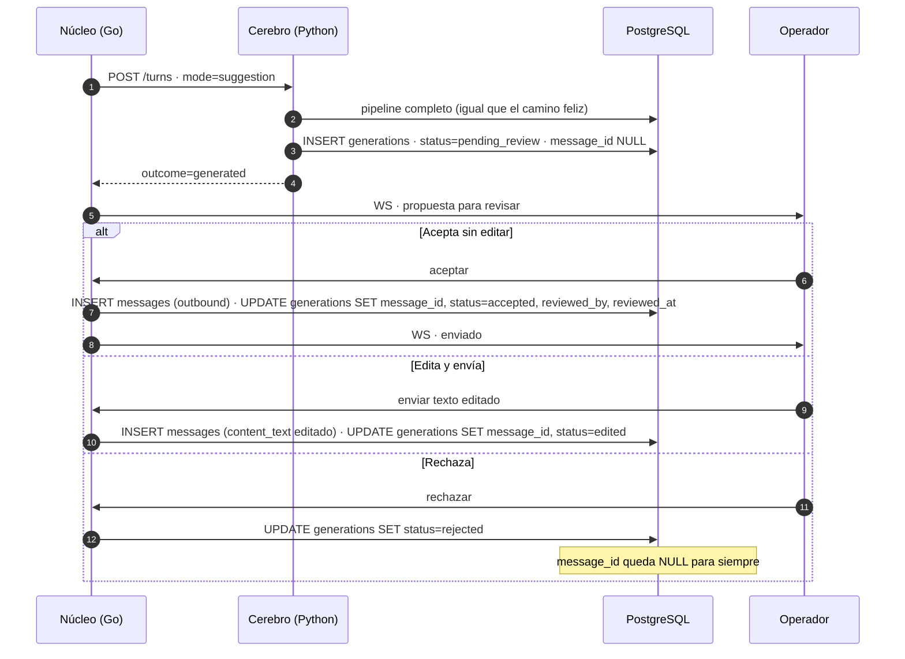
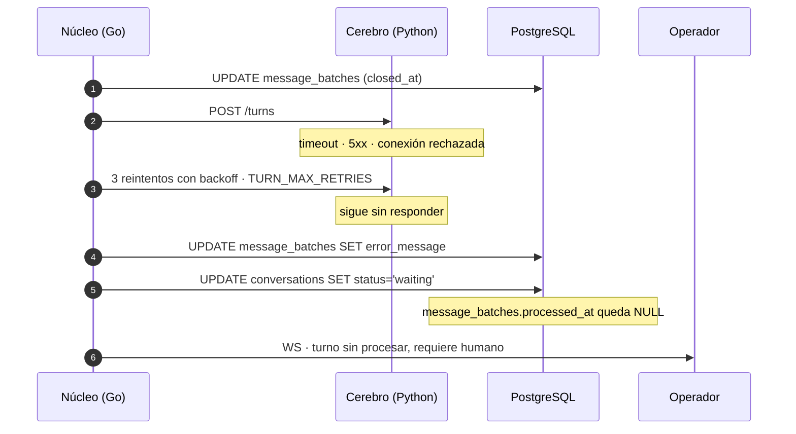

# SONIA — Secuencia del turno

| Campo | Valor |
|---|---|
| **Documento** | `docs/design/07-secuencia-del-turno.md` |
| **Estado** | Borrador para el Paso 8 |
| **Fecha** | 2026-08-22 |
| **Base documental** | [Anteproyecto](../SONIA_Anteproyecto.pdf) — F02, F10, F12, F21, F29 · [ADR-0016](02-decisiones/0016-rastro-del-pipeline-de-respuesta.md) (pipeline) · [ADR-0017](02-decisiones/0017-decomposicion-en-despliegues-y-lenguajes.md) (frontera de procesos) · [03-capa-prompts.md](03-capa-prompts.md) (las cinco reglas) |
| **Complemento** | [DER/entidades.md](DER/entidades.md) — este documento no repite atributos, define **orden y dueño de cada escritura** |

---

## 0. Qué resuelve este documento

El plan lo distingue del diagrama de secuencia que ya existe: *"ése es de **transporte** (webhook → agregador → inbox por WebSocket); éste es de **trazabilidad**: qué versión se lee y qué se escribe"*.

Con ADR-0017 se agrega una segunda pregunta que antes no existía: **cuál de los dos servicios escribe cada fila, y en qué orden.** Con una sola base compartida y dos escritores en línea, el orden deja de ser un detalle de implementación.

**El principio que gobierna todo el documento:**

> **El cerebro propone, el núcleo ejecuta.**
>
> Python escribe **evidencia** —lo que observó, lo que evaluó, lo que generó—. Go escribe **acciones** —el mensaje que sale, la transferencia que ocurre, el estado de la conversación—. Ninguna acción con efecto externo o cambio de estado se escribe desde el cerebro.

De ahí sale la regla operativa: **el cerebro nunca escribe `conversations` ni `messages`.** Si lo hiciera, una respuesta podría quedar registrada como enviada sin haberse enviado, o el estado de la conversación podría cambiar sin que el núcleo lo sepa.

### Los tres escritores

| Escritor | Se despliega | Escribe |
|---|---|---|
| **Núcleo** (Go) | Sí | `webhook_events` · `messages` · `conversations` · `message_batches` · `transfer_events` · `conversation_assignments` · `contacts` · `operators` · `labels` · `contact_labels` · `conversation_labels` · `reminders` · `sales` · `quick_replies` · `internal_notes` · `inboxes` · `meta_templates` · `audit_logs` · ABM de `ai_agents`, `prompt_components`, `prompt_component_versions`, `transfer_policies` |
| **Cerebro** (Python) | Sí | `pipeline_steps` · `detected_intents` · `signal_evaluations` · `conversation_contexts` (+ versiones) · `generations` · `generation_components` · `retrieval_logs` · `contact_attributes` · `documents` · `document_chunks` (modo `worker`) |
| **Instrumental de evaluación** (Python) | **No** — offline | `conversation_annotations` · `tone_evaluations` |

> **Son tres escritores, no dos.** [ADR-0017 (i).2](02-decisiones/0017-decomposicion-en-despliegues-y-lenguajes.md) lo declara desde la revisión del Paso 8. Y la separación del instrumental no es organizativa: como sus dos tablas son la verdad de terreno de OE3/OE4 y el juicio de tono de OE2, que su único escritor **no se despliegue** es lo que impide que el sistema evaluado escriba su propia nota.
>
> **La regla es por columna, no por tabla, y restringe escrituras y no lecturas.** Los tres leen todo el esquema. En este documento hay un solo caso donde dos servicios escriben la misma tabla —`generations`— y está declarado como excepción en ADR-0017 (i).2, con la regla que lo ordena: **el cerebro es dueño de la fila hasta que responde; desde ahí es del núcleo.**

> **El ABM de los componentes es del núcleo; el render es del cerebro.** [ADR-0017 (h)](02-decisiones/0017-decomposicion-en-despliegues-y-lenguajes.md) declara el ensamblador único. La previsualización de F03 es una llamada del núcleo al cerebro, no una segunda implementación: si el ensamblado se rehace en Go *"porque son seis textos concatenados"*, **OE1 mide un render distinto del que ve el administrador**.

---

## 1. El contrato del salto

Un solo salto sincrónico por turno. [ADR-0017 (e)](02-decisiones/0017-decomposicion-en-despliegues-y-lenguajes.md) declara que **el cerebro se expone como API interna** —HTTP + JSON, con contrato OpenAPI que además es entregable de la Fase 3—, sin cola de mensajes: 7.3 deja MQTT fuera de alcance. Y su sección de consecuencias declara el costo con todas las letras: *"hay un salto de red en el camino caliente de cada turno"*, que es el que abre la Rama C de §5.

**Petición** — `POST /turns`

```json
{
  "message_batch_id": "uuid",
  "conversation_id":  "uuid",
  "ai_agent_id":      "uuid",
  "mode":             "autonomous | suggestion"
}
```

El cerebro **lee el resto desde PostgreSQL**. No se duplica estado en el cuerpo: la base es la fuente compartida y reenviar el contenido de los mensajes abriría la puerta a que los dos servicios trabajen sobre versiones distintas del mismo turno.

`mode` viaja explícito y no se deduce: el comportamiento del pipeline lo fija el contrato, no una lectura que cada servicio podría hacer en momentos distintos.

**Respuesta**

```json
{
  "outcome":        "generated | blocked | failed",
  "generation_id":  "uuid | null",
  "completion_text":"string | null",
  "transfer": {
    "proposed":             true,
    "signal_evaluation_id": "uuid"
  } | null
}
```

**`transfer.proposed` es una propuesta, no un hecho.** El cerebro ya escribió las cuatro `signal_evaluations` del turno —disparen o no, según [ADR-0014](02-decisiones/0014-medicion-de-oe3-y-oe4.md)— y señala cuál cruzó el umbral. **La fila de `transfer_events` la escribe el núcleo**, en la misma transacción en que mueve `conversations.status` y `operator_id`.

> **Por qué la transferencia no puede escribirla el cerebro.** El catálogo ya separa las dos cosas: `signal_evaluations` es la evidencia y `transfer_events` es la acción. Si la acción se escribiera en Python y el cambio de estado en Go, la transferencia quedaría partida entre dos servicios **sin una transacción que la abarque** — y el estado intermedio (evento escrito, conversación todavía en manos de la IA) es exactamente el que produce una conversación transferida que nadie atiende.

---

## 2. Camino feliz — modo autónomo



### Cinco puntos de orden que importan

**El 200 a Meta va antes de procesar.** La plataforma reintenta el webhook si no recibe respuesta rápida, y un reintento sobre un turno en curso duplicaría el trabajo. La idempotencia por `wamid` cubre el caso, pero conviene no depender de ella para lo que el orden ya resuelve.

**La generación se escribe después del guardrail de salida, no antes.** Es lo que permite que `generations.status` se escriba **una sola vez y ya con su veredicto** —`auto_sent`, `pending_review` o `blocked`— sin necesitar un estado provisional que nombre el intervalo entre generar y filtrar. El costo hay que decirlo: si el cerebro cae **durante** el guardrail de salida, esa generación se pierde y sólo quedan sus `pipeline_steps`. Es la contrapartida aceptada de no agregar un sexto valor a la enumeración.

**`auto_sent` no afirma que el mensaje llegó.** `GenerationStatus` describe el resultado del **filtrado**; la **entrega** vive en `messages.status`, que ya distingue `sent · delivered · read · failed`. Una generación `auto_sent` cuyo `message_id` apunta a un mensaje `failed` es una fila coherente: pasó el filtro y no llegó.

**El mensaje saliente se escribe antes de enviarse.** Si se enviara primero y el proceso cayera, quedaría un mensaje entregado al cliente sin registro — y `messages` **no admite borrado ni corrección** (F29, C09), así que ese hueco sería permanente. Escribiendo primero, un envío fallido deja una fila con `status = 'failed'` y `error_code`, que es un estado recuperable y visible.

**`processed_at` se escribe adentro de la misma transacción, y es lo que cierra el turno.** Es la marca que separa un turno **procesado** de uno que **nunca llegó a procesarse** (§5), así que tiene que quedar escrita junto con sus efectos: si el mensaje se escribiera y `processed_at` no, un reinicio del núcleo no podría saber si el turno se completó. Con esta regla, **un bloque con `closed_at` y sin `processed_at` significa una sola cosa: nadie lo terminó.**

### Sobre la reescritura del contexto

Ocurre **antes** del ensamblado, no después: [03-capa-prompts.md §4.5](03-capa-prompts.md) muestra que la generación referencia la versión de contexto **del turno que se está respondiendo**. El orden es: cerrar bloque → reescribir contexto (t+1) → ensamblar con esa versión → generar.

---

## 3. Rama A — Modo sugerencia (F02)

La diferencia es **una sola y es grande: no se crea el mensaje.**



**El núcleo sigue siendo el único dueño de `messages`**, y eso es lo que mantiene la rama limpia: mientras la generación está en `pending_review` hay generación y no hay mensaje, que es exactamente lo que `generations.message_id` nullable representa.

**La tasa de edición sale gratis:** comparar `messages.content_text` con `generations.completion_text` cuando `status = 'edited'`. El catálogo ya lo anticipa.

**Una transferencia propuesta en modo sugerencia no se escribe.** Si el clasificador dispara mientras la conversación ya está bajo revisión humana, el cerebro lo informa en la respuesta y el núcleo **no escribe `transfer_events`**: esa tabla registra **la acción de transferir**, y acá no hay acción posible — la conversación ya está en manos de un operador. La evaluación no se pierde: `signal_evaluations` la conserva igual, con su `score`, su `threshold_used` y su `classifier_version` (ADR-0014), así que **OE4 no se ve afectada**.

> **Consecuencia que hay que declarar.** El conjunto de prueba de **OE3** —las 200 conversaciones anotadas— debe elegirse entre conversaciones en **modo autónomo**. La consulta queda correcta sola, porque su población sale de `transfer_events`; pero la anotación es manual, y anotar conversaciones supervisadas llenaría el conjunto de casos en los que transferir era una operación vacía. Está escrito como supuesto S4 en [05-consultas-de-metricas.sql](05-consultas-de-metricas.sql).

---

## 4. Rama B — Corte temprano por blocked-list o guardrail

Dos cortes, en dos momentos distintos, con consecuencias distintas.

### B.1 — Corte de entrada (antes de generar)

El primer `blocklist` o el primer `guardrail` devuelve `blocked`.

| Orden | Quién | Qué |
|---|---|---|
| 1 | Cerebro | `INSERT pipeline_steps` con `outcome = 'blocked'`. **El pipeline se detiene ahí**: no hay triage, ni RAG, ni generación |
| 2 | Cerebro | Responde `outcome = 'blocked'`, sin `generation_id` ni `completion_text` |
| 3 | Núcleo | **No escribe `messages`.** No hay respuesta automática |
| 4 | Núcleo | `UPDATE conversations SET status = 'waiting'` **y `UPDATE message_batches SET processed_at`**, en la misma transacción |
| 5 | Núcleo | WS a los operadores: requiere atención humana |

El bloque queda con `processed_at` puesto: **el turno se procesó**, y su resultado fue no responder. Es distinto de un turno fallido (§5).

### B.2 — Corte de salida (después de generar)

El `guardrail` de salida rechaza la respuesta ya generada.

| Orden | Quién | Qué |
|---|---|---|
| 1 | Cerebro | `INSERT pipeline_steps` · `guardrail` · `direction = 'outbound'` · `outcome = 'blocked'` |
| 2 | Cerebro | `INSERT generations` con **`status = 'blocked'`** y `message_id NULL`, más sus `generation_components`. La evidencia se conserva: hay que poder mostrar *qué* se frenó y con qué prompt se produjo |
| 3 | Cerebro | Responde `outcome = 'blocked'` **con `generation_id`** — la evidencia existe y hay que poder señalarla |
| 4 | Núcleo | No escribe `messages`. `generations.message_id` queda NULL para siempre |
| 5 | Núcleo | `UPDATE conversations SET status = 'waiting'` **+ `UPDATE message_batches SET processed_at`** + WS |

> **`blocked` es un valor nuevo de `GenerationStatus`** (decisión del Paso 8, ya aplicada al catálogo). Los cinco valores originales —`auto_sent · pending_review · accepted · edited · rejected`— **describen todos resultados de revisión humana**, porque la enumeración es anterior a ADR-0016, que introdujo el guardrail de salida. Usar `rejected` sería afirmar que un operador la rechazó, que es falso; dejarla en `auto_sent` sería afirmar que salió sin revisión, que también es falso. Sin el valor nuevo, mirando sólo `generations` no se distingue una respuesta bloqueada de una **huérfana por caída del cerebro** (§5): las dos tienen `message_id NULL`.
>
> **También aplica en modo sugerencia.** El guardrail de salida corre antes de que la propuesta llegue a la bandeja, así que una generación bloqueada **nunca se le muestra al operador**: termina en `blocked` sin pasar por `pending_review`.

---

## 5. Rama C — Cerebro caído



**El mensaje del cliente nunca se pierde**: ya está en `messages` desde el paso 3 del camino feliz, mucho antes del salto.

**`message_batches.processed_at IS NULL` con `closed_at IS NOT NULL` es la marca de un turno cerrado y no procesado.** El catálogo ya tenía los tres relojes separados (`opened_at`, `closed_at`, `processed_at`); esta rama les da uso.

**Cuántos reintentos: tres, y el número es configurable por variable de entorno** (`TURN_MAX_RETRIES`), no una constante de código. El límite real no es técnico sino humano: **del otro lado hay un cliente esperando en WhatsApp.** Un cerebro que se está reiniciando vuelve en segundos; si tarda más que eso, un operador contesta antes que cualquier reintento. Por eso el presupuesto total del turno se mantiene en el orden de los diez segundos, y tres intentos con backoff corto es lo que entra adentro de ese presupuesto. Que sea configurable importa porque **el valor correcto se descubre midiendo en la Fase 4**, no decidiéndolo ahora: si el cerebro resulta más estable de lo previsto, tres reintentos son dos de más; si es menos, cambiar una variable no es cambiar el sistema.

**Por qué falló queda escrito.** `message_batches.error_message` (nullable, agregado en el Paso 8) lo guarda: lo escribe el núcleo —dueño de la tabla— en la misma operación en la que declara el turno fallido. Sin él, esta rama sólo deja `processed_at IS NULL`, que alcanza para **contar** turnos fallidos y no para **diagnosticarlos**; en la Fase 4, distinguir *"el cerebro no respondió"* de *"el proveedor de LLM devolvió 429"* son dos acciones correctivas distintas. Es texto libre, siguiendo el precedente de `webhook_events.error_message` (F20), con la limitación declarada: **diagnostica un turno, no agrega por causa.**

### Dos reglas que hay que sostener

**No se reprocesa automáticamente.** Si el cerebro vuelve y encuentra bloques cerrados sin procesar, **no los procesa**: la conversación ya cayó a `waiting` y es probable que un humano haya respondido. Una respuesta de IA generada sobre un contexto que ya avanzó es peor que ninguna respuesta.

**Falla parcial.** El cerebro puede caerse a mitad del pipeline, y **lo que queda depende de dónde**:

- **Antes del guardrail de salida** —el caso común— quedan los `pipeline_steps` escritos hasta ahí y **ninguna fila de `generations`**, porque la generación se escribe recién al final (§2). Esa evidencia parcial **se conserva**: es el registro de lo que alcanzó a ocurrir.
- **Entre la respuesta del cerebro y la transacción del núcleo** —ventana angosta, pero real— queda una generación escrita que nunca se enlazó a ningún mensaje. Acá el que se cayó es el núcleo, no el cerebro.

**`message_id IS NULL` ya no identifica ese segundo caso.** Con `blocked` en la enumeración, hay tres estados que lo cumplen **legítimamente**: una respuesta bloqueada por el guardrail, una sugerencia rechazada por un operador y una sugerencia todavía en revisión. El identificador correcto de una generación realmente huérfana es:

```sql
status = 'auto_sent' AND message_id IS NULL
```

*Pasó el filtro y nunca se enlazó.* Es una combinación que **no puede ser cierta nunca** si el sistema funciona: sirve como chequeo de consistencia, y es exactamente el rastro que deja una caída del núcleo entre el salto y su transacción.

---

## 6. Lo que apareció al dibujar las ramas

Cinco puntos. **Cuatro quedaron decididos** y ya están aplicados; el quinto se
difiere al Paso 7 porque es una decisión del modelo físico.

| # | Qué apareció | Decisión | Dónde quedó |
|---|---|---|---|
| **1** | **`GenerationStatus` no tenía valor para "bloqueada por el sistema".** Sus cinco valores describen revisión humana; ADR-0016 introdujo un corte automático posterior a la generación | ✅ **Se agrega `blocked`.** Además se fija **quién escribe `status` y cuándo**: el cerebro, una sola vez, después del guardrail de salida | `DER/entidades.md` — enumeración y nota de `generations` · §2 y §4.2 de este documento |
| **2** | **La consulta de OE7 no contemplaba el modo sugerencia.** Filtraba por `messages.sender_type = 'operator'`, pero una sugerencia **aceptada** produce un mensaje de la IA que un humano revisó: contaba como autónoma e **inflaba OE7** | ✅ **Se excluye la conversación si alguna generación tiene `reviewed_by_operator_id IS NOT NULL`.** Es evidencia directa de intervención humana y cubre los tres desenlaces de F02 | `05-consultas-de-metricas.sql` — supuesto S4 de OE7, aplicado también a F36.a |
| **3** | **Los salientes no tienen `wamid` hasta que Meta responde.** `messages.wamid` es único y es la clave de idempotencia de los entrantes; para los salientes es NULL al momento de escribir. PostgreSQL admite múltiples NULL en un índice único, así que funciona — pero **la idempotencia de salida es otro mecanismo y no está definido** | ⏸️ **Diferido al Paso 7** (modelo físico). No es un hueco del modelo lógico: es una clave de idempotencia y una estrategia de reintento de envío | Agenda del Paso 7 |
| **4** | **No había dónde registrar por qué falló un turno.** `message_batches` no tenía campo de error; la rama C sólo dejaba `processed_at IS NULL` | ✅ **Se agrega `message_batches.error_message`** (text, nullable), siguiendo el precedente de `webhook_events.error_message` (F20). Texto libre: diagnostica un turno, no agrega por causa | `DER/entidades.md` · §5 de este documento |
| **5** | **Transferencia propuesta en modo sugerencia.** ¿Se escribe el `transfer_event` si la conversación ya está en revisión humana? | ✅ **No se escribe.** `transfer_events` registra **la acción de transferir**, y ahí no hay acción posible. La evaluación se conserva en `signal_evaluations`, así que OE4 no se afecta. **Consecuencia:** el conjunto anotado de OE3 se elige entre conversaciones en modo autónomo | §3 de este documento · supuesto S4 de OE3 en `05-consultas-de-metricas.sql` |

> **Ninguno de los cinco era visible desde el catálogo.** Los cuatro primeros
> aparecen sólo cuando se dibuja **el orden** de las escrituras y **quién** hace
> cada una; el quinto, cuando se cruzan dos ramas que hasta ahora se habían
> pensado por separado. Es la misma lección del Paso 6 —la matriz encuentra
> entidades faltantes, la consulta encuentra combinaciones imposibles— aplicada
> al comportamiento: **la secuencia encuentra estados que el modelo no sabe
> nombrar.**
>
> **Y el hallazgo 2 tiene el sabor de los del Paso 6:** una métrica que devolvía
> un número más alto que el real, con el dato correcto ya presente en el modelo
> y sin usar. No faltaba nada; faltaba mirarlo.

---

## 7. Decisiones del Paso 8

Las cinco preguntas que abrió este documento quedaron cerradas así:

| # | Pregunta | Decisión |
|---|---|---|
| 1 | ¿Se agrega `blocked` a `GenerationStatus`? | **Sí.** Y `status` lo escribe el cerebro una sola vez, después del guardrail de salida. La entrega se lee en `messages.status`, no acá |
| 2 | ¿Cómo queda el `WHERE` de OE7? | **Excluir si existe una generación con `reviewed_by_operator_id IS NOT NULL`** |
| 3 | ¿Cuántos reintentos antes de declarar el turno fallido? | **Tres**, con backoff, **configurables por variable de entorno** (`TURN_MAX_RETRIES`) |
| 4 | ¿Se registra el motivo de la falla? | **Sí**, en `message_batches.error_message` (text, nullable), escrito por el núcleo |
| 5 | ¿`transfer_events` en modo sugerencia? | **No se escribe.** La evidencia queda en `signal_evaluations` |

**Lo que queda abierto y no es de este paso:** la idempotencia de los mensajes
salientes (hallazgo 3), que es modelo físico y va al **Paso 7**.

---

## 8. Qué toca este documento del resto del diseño

| Documento | Qué cambió |
|---|---|
| `DER/entidades.md` | `GenerationStatus` gana `blocked` · `message_batches` gana `error_message` · nota nueva en `generations` sobre quién escribe `status` |
| `DER/relaciones.md` | **Nada.** Ninguna relación nueva |
| `DER/guia-de-dibujo.md` | `error_message` en el bloque de `message_batches` |
| `docs/diagrams/der-logico-scaffold.mmd` | **Nada.** El andamio sólo dibuja relaciones |
| `05-consultas-de-metricas.sql` | Supuesto S4 y `WHERE` corregido en OE7 y F36.a · supuesto S4 en OE3 |
| `01-trazabilidad.md` | H-26 a H-31 (§5.4) — incluye un tipo nuevo, `consulta` |
| `02-decisiones/0017-…` | (i).2 pasa a propiedad por columna, declara el tercer escritor y la excepción de `generations` · (i).3 corregido (H-26) · §0 con la segunda pasada |

**Los contadores del modelo no se mueven: 37 entidades, 73 relaciones,
22 enumeraciones.** Este paso agregó **un valor** a una enumeración existente y
**una columna** a una entidad existente — no entidades ni relaciones. Es el
resultado que uno espera de un paso de comportamiento cuando el modelo de datos
está bien: si dibujar la secuencia hubiera obligado a crear entidades, el Paso 5
habría estado incompleto.
